# The pipeline

One route for every change. Seven stages, each proving one thing, each leaving one evidence state in the change record. Skipping a stage is possible only through a declared lane.

```mermaid
flowchart LR
    S[STORY-NNN<br/>DEFINED] --> P1[/plan-task/]
    P1 -->|PLANNED| P2[/validate-design/]
    P2 -.->|blockers| P1
    P2 -->|DESIGN-VALIDATED| P3[/develop-code/]
    P3 -->|DEVELOPED| P4[/test-acceptance/]
    P4 -->|ACCEPTANCE-TEST-PROVEN| P5[/clear-review/]
    P5 -.->|fixes on branch| P4
    P5 -->|REVIEW-CLEARED| P6[/test-regression/]
    P6 -->|REGRESSION-TEST-PROVEN| P7[/deploy-change/]
    P7 -->|DEPLOYED| M[main, deployed,<br/>verified live]
```



## The seven stages

| # | Stage | Command | Proves | Accountable | Cost of a miss caught here |
|---|---|---|---|---|---|
| 1 | Plan | `/plan-task` | the change is understood: discovery, scope, risks, acceptance map, routing | Marketa | minutes |
| 2 | Validate | `/validate-design` | the design survives adversarial and specialist attack on paper | Marketa | minutes |
| 3 | Develop | `/develop-code` | the contract was built, in scope, fast gate green | Michal | an hour |
| 4 | Accept | `/test-acceptance` | every criterion has a named, passing proof, including UI proofs | Bruno | hours |
| 5 | Review | `/clear-review` | independent lenses, a second model family and a generalist cleared the diff | Sipk.ai | hours to days |
| 6 | Regress | `/test-regression` | the complete matrix passes on the exact reviewed commit | Bruno | a broken release candidate |
| 7 | Deploy | `/deploy-change` | hard gate, staged deploy, live verification, rollback known | Ivan | a production incident |

Each stage exists because catching the same mistake one stage later costs roughly ten times more. Each stage page under `skills/` has the same shape: who, input, output, hard rule, steps, scripts and checks, model tier, exit condition, the rules that bind it.

## Who does what, stage by stage

A: accountable for the stage's verdict. D: does the work. C: consulted, gives findings or a decision. The founder's column lists the human checkpoints by risk tier (R-5.2).

| Stage | Sipk.ai | Miro | Marketa | Michal | Bruno | Adam | Ivan | Tina | Independent reviewer | Founder |
|---|---|---|---|---|---|---|---|---|---|---|
| Before Plan: the story | | A, D | C | | | | | | | story selection, readiness |
| Plan | orchestrates | C | A, D | | C | C | | C budget | | readiness (STANDARD+) |
| Validate | orchestrates | C lens | A, D | | | C lens | C | | C (Risk above LOW) | design approval (HIGH+), authority, billable resources |
| Develop | orchestrates, ledger | | C on deviations | A, D | | | | | | |
| Accept | orchestrates | C does it solve the problem | | C fixes | A, D | | | | | outcome acceptance (HIGH+) |
| Review | A, generalist pass | C lens | C lens | C fixes | C test diff, doc drift | C lens | C control plane | | C (Risk above LOW) | merge (HIGH+), control-plane verdicts |
| Regress | orchestrates | | | | A, D | | C | | | |
| Deploy | orchestrates | | | | | C | A, D | | | release approval, starts the deploy |
| Always | enforces `AGENTS.md` | owns the backlog | | | | | owns the gate, hooks, CI | ledger, metrics, proposals | | approves every change to the method |

## Evidence states and the change record

```text
DEFINED (story) -> PLANNED -> DESIGN-VALIDATED -> DEVELOPED -> ACCEPTANCE-TEST-PROVEN
                -> REVIEW-CLEARED -> REGRESSION-TEST-PROVEN -> DEPLOYED
```

One file travels the route, created from `templates/change-record.md`. Each stage fills its own section:

| Stage | Section | Outcome line |
|---|---|---|
| Plan | Discovery Brief | `Planning outcome: PLANNED` |
| Validate | Design Verdict | `Design outcome: DESIGN-VALIDATED` |
| Develop | Implementation Record | `Development outcome: DEVELOPED` |
| Accept | Acceptance Evidence | `Acceptance outcome: ACCEPTANCE-TEST-PROVEN` |
| Review | Review Verdict | `Review outcome: REVIEW-CLEARED` |
| Regress | Regression Certificate | `Regression outcome: REGRESSION-TEST-PROVEN` |
| Deploy | Deployment Record | `Deployment outcome: DEPLOYED` |

The change-record checker runs on every commit and enforces R-2.4 to R-2.8: the stage never outruns its evidence, metadata is present, no placeholders, receipts exist, the Definition of Done is checked. Reopening a stage resets everything after it to `PENDING` (R-2.9).

## The gates

Instructions are soft; an agent under context pressure will eventually skip one. These are hard:

| Gate mode | Runs | When |
|---|---|---|
| `--fast` | required tools, change-record states, links, doc drift, secrets, improvement approvals, project static analysis and fast tests | every commit (the hook) |
| `--full` | `--fast` plus project build, full automated tests, dependency vulnerabilities, Sipk.ai self-test | regression proof, before merge, CI |
| `--ui` | `--full` plus the project's UI journeys and accessibility checks | UI-touching stories, before releases |
| `--deploy` | `--ui` plus deployment-bound checks | `/deploy-change` |

The gate fails closed, runs identically in the hook, in CI and at deploy (R-3.21), and grows a new check for every new class of drift or defect (R-3.22). Required CI on a protected branch is the enforcement boundary; the local hook is fast feedback (R-8.14).

## Lanes: the sanctioned shortcuts

| Lane | Stages run | When it applies |
|---|---|---|
| Full | all seven | any change a user can observe, any money, security, data or infrastructure change |
| Test-only | Develop, Accept, Regress, Deploy, with a short plan note | adding or fixing tests with zero production-code change |
| Docs/process-only | edit plus the fast gate at commit | docs, rules, skills, templates; batched between stories, control-plane edits still reviewed by the owner |
| Hotfix | Develop, Accept, Regress, Deploy now; Discovery Brief and Design Verdict written retroactively the same day | production is broken and users are hurting |
| Bootstrap | the project's documented one-time sequence before the gate exists | creating the repository and the first gate; never repeated |

The lane is said out loud at the start and written in the record's `Lane:` field (R-4.1). `--no-verify` is not a lane (R-4.7).

## Risk tiers and human checkpoints

| Risk | Typical change | Executing tier | Human checkpoints |
|---|---|---|---|
| LOW | isolated, reversible, no durable contract | `small` when mechanical and fully specified | story selection, final deploy decision |
| STANDARD | normal product behavior with tested rollback | `mid` | story readiness, final deploy decision |
| HIGH | security, money, privacy, migration, public contract, broad dependency change, control-plane files | `top` | story readiness, design approval, outcome acceptance, merge |
| CRITICAL | irreversible actions, regulated behavior, destructive data change, production authority expansion | `top` | named owner approval at every transition plus independent review |

Size sets the budget: S 300k, M 750k, L 1.5M, XL 3M tokens for the whole pipeline; XXL is split first (R-7.9).

## The layered quality stack

| Layer | Question | Control |
|---|---|---|
| Planning | Are we solving a clear problem, and do we understand the current system? | ready checklist, repository exploration, decisions, context manifest |
| Design validation | Is this the smallest design that fits the product and its single owners? | devil's advocate, lenses, independent reviewer, rollback and authority checks |
| Development integrity | Do code, tests, docs, decisions and contracts agree? | narrow tests, fast gate, drift checks, governance self-check |
| Acceptance | Does the requested outcome work, including adverse and UI behavior? | criterion-to-proof map, targeted and UI tests |
| Independent review | What could still be wrong despite green tests? | read-only lenses, second family, generalist diff review, test-diff review |
| Regression | Did the reviewed combined system stay healthy? | complete deterministic matrix and required CI on one SHA |
| Deployment authority | Should this exact candidate go live? | human decision, protected merge, staged deploy, live observation, rollback |

The model may vary its proposal. The evidence required to reach production does not vary.

## A story end to end

How "fix a wrong category in one tap" runs through the team:

1. **Miro** has the story `DEFINED`: outcome, owner, falsifiable criteria, non-goals, risk and size on the board. The founder picks it.
2. **`/plan-task`.** Sipk.ai opens a fresh session. Marketa maps the blast radius, searches the decisions, writes the Discovery Brief with the acceptance map, routes the tier and sets the budget. Miro confirms the criteria still say what the product needs. `PLANNED`.
3. **`/validate-design`.** Marketa attacks her own brief as devil's advocate; Adam and Miro read it through their lenses in parallel; the independent reviewer judges the pack from outside. One blocker lands, the record is amended. `DESIGN-VALIDATED`.
4. **`/develop-code`.** Michal builds on a story branch at the routed tier, docs in the same commit, fast gate green, self-check against the governance rules. Sipk.ai writes the measured spend into the record. `DEVELOPED`.
5. **`/test-acceptance`.** Bruno gives every criterion a named proof, a Playwright test for what the user sees, and a counterexample that shows each test can fail. `ACCEPTANCE-TEST-PROVEN`.
6. **`/clear-review`.** Marketa, Adam, Miro and Bruno review the diff in parallel; the independent reviewer judges it from outside; Sipk.ai does the generalist pass, consolidates one table, and has Michal fix the one HIGH finding and re-run its proof. `REVIEW-CLEARED`.
7. **`/test-regression`.** Bruno runs the full gate on the exact reviewed SHA and issues the certificate. `REGRESSION-TEST-PROVEN`.
8. **`/deploy-change`.** The founder says ship. Ivan re-runs the hard gate on the merge candidate, merges through the protected route, prepares the exact deploy command, and the founder starts it. Ivan verifies live behavior and records the rollback status. `DEPLOYED`.
9. **Tina** adds the story to the bill, updates the delivery metrics, and files the one thing the story taught as a proposal.
