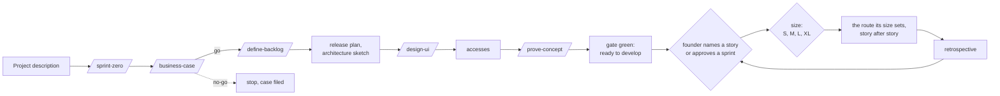

# The SDLC: how the pod delivers

This folder is the pod's process, level 3 of the hierarchy under `CLAUDE.md`:

| Part | What it holds |
|---|---|
| this page | the whole flow: Sprint 0, sprints, the seven stages, the retrospective, the gates, lanes and risk tiers, who does what, what runs on its own |
| `RULES.md` | every rule as a numbered paragraph, the detail behind each line of this page |
| `skills/` | one page per step, also the slash command: `sprint-zero`, `business-case`, `define-backlog`, `design-ui`, `prove-concept`, then the seven stages |
| `scripts/` | the gate and its checks: what makes the rules hard instead of hopeful |
| `evals/` | known good and known bad cases that prove every check still bites |

## The flow from a project description to working software



1. **Sprint 0** (`/sprint-zero`, R-2.5). Once per project, time-boxed. It ends when the team is ready to develop: the founder said go on the business case, the backlog is ordered, the riskiest assumption is proven, the mocks are approved, every access works and the gate is green.
2. **The founder names a story, or approves a sprint** (R-2.4): an ordered list of stories from the top of the board.
3. **Each story runs the route its size sets** (R-2.8): S in one session, M in two, L in three, XL through the seven stage pages; an XXL is split first. Every session is fresh, started by Sipk.ai, and leaves its evidence in the change record. Stories in a sprint run two at a time where they are independent (no blocking link, no shared declared files), each in its own worktree, and merge one at a time; a story never starts while a story it depends on is open (R-2.4).
4. **After every story the team sits down** (R-10.2): Tina's one-page retrospective with the bill and at most three lean proposals.
5. **After the sprint** Sipk.ai reports to the founder: what shipped, what it cost, what was learned, and the recommended next sprint.

### What runs on its own, and what waits for the founder

| Runs on its own | Waits for the founder |
|---|---|
| every stage of a named story or an approved sprint, two independent stories at a time | go or no-go on the business case |
| design questions, answered with the best-supported option and reported (R-6.3) | approving the mocks |
| the second opinion, through the API | creating account-level accesses only he can create |
| deploying to development inside an approved story (R-5.2) | naming the story or approving the sprint |
| merging and pushing `main` where the project allows it | a production release |
| writing improvement proposals | approving any change to the method |
| | a budget crossed, money beyond a story, deletions, permission widening at account level |

## Five sizes

| Size | What it is | Route | Sessions | Who works on it | Approx. tokens |
|---|---|---|---|---|---|
| **S** | a small, clear change of a few files | `/quick` | 1 | Michal, Bruno, one fresh reviewer, Ivan | 300k, 450k at HIGH |
| **M** | a contained feature or change | `/build`, `/ship` | 2 | plus one or two reviewers | 800k, 1.1M at HIGH |
| **L** | a feature with design choices, or a new contract, dependency or screen | `/design`, `/build`, `/ship` | 3 | plus Marketa, up to three reviewers, Erik for a screen | 1.6M, 2.1M at HIGH |
| **XL** | a large or architectural change, and every CRITICAL story | the seven stage pages | 7 | the whole team | 3M, 3.6M at HIGH or CRITICAL |
| **XXL** | too big to build as one story | `/business-case` with feasibility, then `/define-backlog` | n/a | Miro, Marketa, Tina, Erik | split into S to XL stories |

Risk never shrinks a route; it adds controls on top: at STANDARD and above the second model family reviews the diff; at HIGH the work runs on the top model and Adam's lens joins every review; a CRITICAL story is always XL, with the founder's design approval. Every size keeps a proof that can fail for every acceptance criterion, the gate on the exact commit with its receipt, a reviewer who is not the builder, one change record, the measured bill and the founder's authority. A surprise moves a story up a size at once, never down (R-2.8). The token figures are budgets: XL sits above what the first ten full-route stories measured; S, M and L are set from the measured stage averages and re-measured every ten stories.

## Sprint 0

| Step | Skill | Output in the project workspace | Owner | Gate |
|---|---|---|---|---|
| Business case | `/business-case` | `business-case.md` | Miro | **the founder's go** |
| Workspace and bridge | `adopt.sh` | `sdlc.config.sh`, `AGENTS.md`, the workspace folders | Ivan | |
| Backlog | `/define-backlog` | the board, ready stories, epics, open questions | Miro | Defined gate per story |
| Plan | in `/sprint-zero` | `sprint-0/release-plan.md`, `sprint-0/architecture.md`, decision records | Marketa | |
| UI and mocks, design system | `/design-ui` | `sprint-0/mocks/`, `sprint-0/design-system.md` | Erik | **the founder's approval** |
| Accesses | in `/sprint-zero` | `sprint-0/accesses.md`, deny rules tested | Ivan, Adam | every access checked |
| Proof of concept | `/prove-concept` | `sprint-0/poc.md`, a spike branch | Marketa | a measured result |
| Gate and CI | `install-hooks.sh` | hook, CI, a green fast gate | Ivan | gate green |

## The seven stages

| # | Stage | Command | Proves | Accountable | Cost of a miss caught here |
|---|---|---|---|---|---|
| 1 | Plan | `/plan-task` | the change is understood: discovery, scope, risks, acceptance map, routing | Marketa | minutes |
| 2 | Validate | `/validate-design` | the design survives adversarial and specialist attack on paper | Marketa | minutes |
| 3 | Develop | `/develop-code` | the contract was built, in scope, fast gate green | Michal | an hour |
| 4 | Accept | `/test-acceptance` | every criterion has a named, passing proof, including UI proofs | Bruno | hours |
| 5 | Review | `/clear-review` | independent lenses, a second model family and a generalist cleared the diff | Sipk.ai | hours to days |
| 6 | Regress | `/test-regression` | the complete matrix passes on the exact reviewed commit | Bruno | a broken release candidate |
| 7 | Deploy | `/deploy-change` | hard gate, staged deploy, live verification, rollback known | Ivan | a production incident |

Each stage exists because catching the same mistake one stage later costs roughly ten times more. Every step page under `skills/` has the same shape: who, input, output, hard rule, steps, scripts and checks, model tier, exit condition, the rules that bind it. Every step begins with `bash sipkai-pod/sdlc/scripts/stage-start.sh`.

## Who does what, step by step

A: accountable for the step's verdict. D: does the work. C: consulted, gives findings or a decision.

| Step | Sipk.ai | Miro | Marketa | Erik | Michal | Bruno | Adam | Ivan | Tina | Independent reviewer | Founder |
|---|---|---|---|---|---|---|---|---|---|---|---|
| Business case | orchestrates | A, D | C feasibility | C users | | | C risk | | C cost | | decides go or no-go |
| Backlog | orchestrates | A, D | C sizes and seams | C journeys | | | C risk | | C sizes against the ledger | | answers the questions |
| Plan and architecture (Sprint 0) | orchestrates | C | A, D | | | | C | C hosting | | | |
| UI, mocks, design system | orchestrates | C | C stack | A, D | | C test ids | C | | | | approves the mocks |
| Accesses | orchestrates | | | | | | C | A, D | | | creates what only he can |
| Proof of concept | orchestrates | | A | | D | D proof | C | C | | | |
| Story selection | | proposes the order | | | | | | | | | names a story or approves a sprint |
| Plan | orchestrates | C | A, D | C new screens | | C | C | | C budget | | |
| Validate | orchestrates | C lens | A, D | C UX lens | | | C lens | C | | C (Risk above LOW) | design approval (CRITICAL only) |
| Develop | orchestrates, ledger | | C on deviations | | A, D | | | | | | |
| Accept | orchestrates | C does it solve the problem | | C states | C fixes | A, D | | | | | |
| Review | A, generalist pass | C lens | C lens | C UX lens | C fixes | C test diff, doc drift | C lens | C control plane | | C (Risk above LOW) | |
| Regress | orchestrates | | | | | A, D | | C | | | |
| Deploy | orchestrates | | | | | | C | A, D | | | production release approval |
| Retrospective | orchestrates | | | | | | | | A, D | | reads three sentences |
| Always | enforces `CLAUDE.md` | owns the backlog | owns the architecture | owns the design system | | | | owns the gate, hooks, CI | ledger, metrics, proposals | | approves every change to the method |

## Evidence states and the change record

```text
DEFINED (story) -> PLANNED -> DESIGN-VALIDATED -> DEVELOPED -> ACCEPTANCE-TEST-PROVEN
                -> REVIEW-CLEARED -> REGRESSION-TEST-PROVEN -> DEPLOYED
```

One file travels the route, created from `templates/change-record.md`. Each stage fills its own section:

| Stage | Section | Outcome line |
|---|---|---|
| Plan | Discovery Brief | `Planning outcome: PLANNED` |
| Validate | Design Verdict | `Design outcome: DESIGN-VALIDATED` |
| Develop | Implementation Record | `Development outcome: DEVELOPED` |
| Accept | Acceptance Evidence | `Acceptance outcome: ACCEPTANCE-TEST-PROVEN` |
| Review | Review Verdict | `Review outcome: REVIEW-CLEARED` |
| Regress | Regression Certificate | `Regression outcome: REGRESSION-TEST-PROVEN` |
| Deploy | Deployment Record | `Deployment outcome: DEPLOYED` |

The change-record checker runs on every commit and enforces R-2.2: the stage never outruns its evidence, metadata is present, no placeholders, receipts exist, the Definition of Done is checked. Reopening a stage resets everything after it to `PENDING` (R-2.2).

## The gates

Instructions are soft; an agent under context pressure will eventually skip one. These are hard:

| Gate mode | Runs | When |
|---|---|---|
| `--fast` | required tools, change-record states, card, board and record agreement, links, doc drift, secrets, improvement approvals, project static analysis and fast tests | every commit (the hook) |
| `--full` | `--fast` plus project build, full automated tests, dependency vulnerabilities, Sipk.ai self-test | regression proof, before merge, CI |
| `--ui` | `--full` plus the project's UI journeys and accessibility checks | UI-touching stories, before releases |
| `--deploy` | `--ui` plus deployment-bound checks | `/deploy-change` |

The gate fails closed, runs identically in the hook, in CI and at deploy (R-3.5), and grows a new check for every new class of drift or defect (R-3.6). Required CI on a protected branch is the enforcement boundary; the local hook is fast feedback (R-3.5).

## Lanes: the sanctioned shortcuts

| Lane | Stages run | When it applies |
|---|---|---|
| Full | every stage, in the sessions the story's size sets (S one, M two, L three, XL seven) | any change a user can observe, any money, security, data or infrastructure change |
| Test-only | Develop, Accept, Regress, Deploy, with a short plan note | adding or fixing tests with zero production-code change |
| Docs/process-only | edit plus the fast gate at commit | docs, rules, skills, templates; batched between stories, control-plane edits still reviewed by the owner |
| Dependency | `/quick` at Size S, 200k | lockfiles only, when `check-dependency-lane.sh` passes: no other file changed, manifests still satisfied, the shipped build byte-identical, the scan green; one review by Adam's lens, no design check or second opinion; a refusal means the full route |
| Hotfix | Develop, Accept, Regress, Deploy now; Discovery Brief and Design Verdict written retroactively the same day | production is broken and users are hurting |
| Bootstrap | the project's documented one-time sequence before the gate exists | creating the repository and the first gate; never repeated |

The lane is said out loud at the start and written in the record's `Lane:` field (R-4.1). `--no-verify` is not a lane (R-4.1).

## Risk tiers and human checkpoints

| Risk | Typical change | Executing tier | Human checkpoints |
|---|---|---|---|
| LOW | isolated, reversible, no durable contract | `small` when mechanical and fully specified | production release only |
| STANDARD | normal product behavior with tested rollback | `mid` | production release only |
| HIGH | security, money, privacy, migration, public contract, broad dependency change, control-plane files | `top` | production release only |
| CRITICAL | irreversible actions, regulated behavior, destructive data change, production authority expansion | `top` | design approval and production release, plus independent review |

Size sets the budget: S 750k, M 2M, L 2.5M, XL 4M tokens for the whole pipeline; XXL is split first (R-7.2).

## The layered quality stack

| Layer | Question | Control |
|---|---|---|
| Planning | Are we solving a clear problem, and do we understand the current system? | ready checklist, repository exploration, decisions, context manifest |
| Design validation | Is this the smallest design that fits the product and its single owners? | a reviewer who is not the builder, lenses by size, the second family at XL, rollback and authority checks |
| Development integrity | Do code, tests, docs, decisions and contracts agree? | narrow tests, fast gate, drift checks, governance self-check |
| Acceptance | Does the requested outcome work, including adverse and UI behavior? | criterion-to-proof map, targeted and UI tests |
| Independent review | What could still be wrong despite green tests? | read-only lenses, the second family on the diff above LOW risk, generalist diff review, test-diff review |
| Regression | Did the reviewed combined system stay healthy? | complete deterministic matrix and required CI on one SHA |
| Deployment authority | Should this exact candidate go live? | human decision, protected merge, staged deploy, live observation, rollback |

The model may vary its proposal. The evidence required to reach production does not vary.

## A story end to end

How "fix a wrong category in one tap" runs through the team:

1. **Miro** has the story `DEFINED`: outcome, owner, falsifiable criteria, non-goals, risk and size on the board. The founder names it to Sipk.ai; from here the pod runs alone.
2. **`/plan-task`.** Sipk.ai opens a fresh session. Marketa maps the blast radius, searches the decisions, writes the Discovery Brief with the acceptance map, routes the tier and sets the budget. Miro confirms the criteria still say what the product needs. `PLANNED`.
3. **`/validate-design`.** Marketa attacks her own brief as devil's advocate; Adam and Miro read it through their lenses in parallel; the independent reviewer judges the pack from outside. One blocker lands, the record is amended. `DESIGN-VALIDATED`.
4. **`/develop-code`.** Michal builds on a story branch at the routed tier, docs in the same commit, fast gate green, self-check against the governance rules. Sipk.ai writes the measured spend into the record. `DEVELOPED`.
5. **`/test-acceptance`.** Bruno gives every criterion a named proof, a UI test for what the user sees, and a counterexample that shows each test can fail. `ACCEPTANCE-TEST-PROVEN`.
6. **`/clear-review`.** Marketa, Adam, Miro and Bruno review the diff in parallel; the independent reviewer judges it from outside; Sipk.ai does the generalist pass, consolidates one table, and has Michal fix the one HIGH finding and re-run its proof. `REVIEW-CLEARED`.
7. **`/test-regression`.** Bruno runs the full gate on the exact reviewed SHA and issues the certificate. `REGRESSION-TEST-PROVEN`.
8. **`/deploy-change`.** Sipk.ai starts the stage once the certificate exists. Ivan re-runs the hard gate on the merge candidate, merges through the protected route, deploys to the development environment and pushes `main`; a production release waits for the founder's yes. Ivan verifies live behavior and records the rollback status. `DEPLOYED`.
9. **Tina** adds the story to the bill, updates the delivery metrics, and files the one thing the story taught as a proposal.
